# Wakfu Combo Overlay

[](https://github.com/utruna/wakfu-combo-overlay/releases)
[](https://github.com/utruna/wakfu-combo-overlay/releases/latest)

Affiche en direct sur ton stream les sorts lancés par tes personnages Wakfu, sous forme d'icônes qui défilent dans OBS. Tu ne streames pas ? L'**affichage tête haute** les montre directement par-dessus le jeu. Après chaque combat, le **récap des combats** te montre qui a fait quoi : dégâts, soins, meilleur tour, sort par sort.


L'application lit les logs de combat du client Wakfu en temps réel. Elle ne garde que les sorts de tes personnages (les autres joueurs et les mobs sont ignorés) et les envoie à une page web transparente que tu ajoutes comme **Source Navigateur** dans OBS.

**[⬇ Télécharger la dernière version](https://github.com/utruna/wakfu-combo-overlay/releases/latest)** (Windows, macOS, Linux)

---

## Sommaire

- [Installation et premier lancement](#installation-et-premier-lancement)
- [Sur macOS et Linux](#sur-macos-et-linux)
- [Gérer tes héros](#gérer-tes-héros)
- [Régler l'affichage](#régler-laffichage)
- [Configurer OBS](#configurer-obs)
- [Affichage tête haute (sans OBS)](#affichage-tête-haute-sans-obs)
- [Récap des combats](#récap-des-combats)
- [Vérifier que tout tourne](#vérifier-que-tout-tourne)
- [Dépannage](#dépannage)
- [Développement](#développement)

---

## Installation et premier lancement

1. Télécharge `wakfu-combo-overlay-setup-X.Y.Z.exe` depuis la [dernière release](https://github.com/utruna/wakfu-combo-overlay/releases/latest) et lance-le. Sur Mac ou sous Linux, voir [plus bas](#sur-macos-et-linux).
2. Windows SmartScreen peut afficher un avertissement, parce que l'installeur n'est pas signé : clique sur **Informations complémentaires** → **Exécuter quand même**.

Tu avais une version 1.x ? L'installeur la désinstalle tout seul et reprend tes réglages (héros, affichage, port, lancement avec Windows) : rien à refaire, ni dans l'appli ni dans OBS.

Au premier lancement, un **assistant en quatre étapes** te guide :

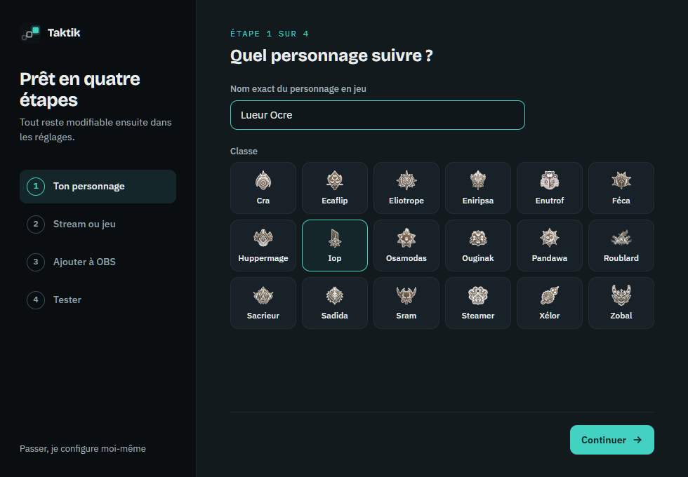

1. **Ton personnage** : saisis son **nom exact en jeu** et choisis sa **classe**.
2. **Stream ou jeu** : choisis le **mode streamer** (les sorts sur ton stream, dans OBS) ou le **mode joueur** (les sorts par-dessus Wakfu, sur ton écran, sans OBS).
3. Selon ton choix :
   - **Ajouter à OBS** : l'assistant te donne le lien à coller et la taille de la source, puis t'indique quand OBS est bien connecté ;
   - **Affichage tête haute** : l'assistant l'active et te montre en un coup d'œil comment t'en servir.
4. **Tester** : envoie un sort factice et vérifie qu'il apparaît, dans ta scène OBS ou en haut à droite de ton écran.

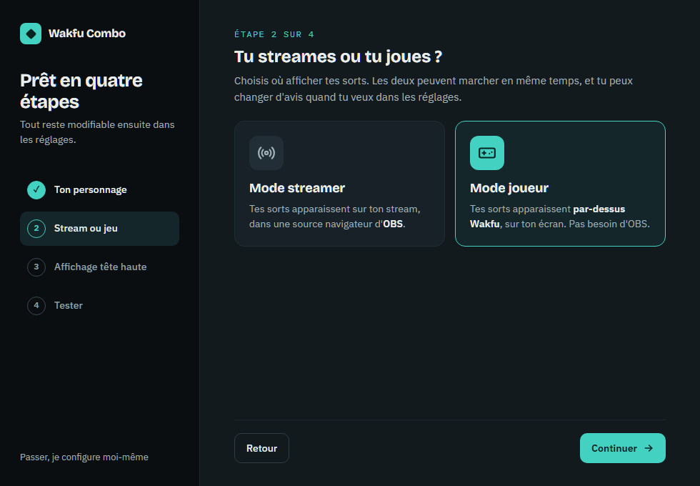

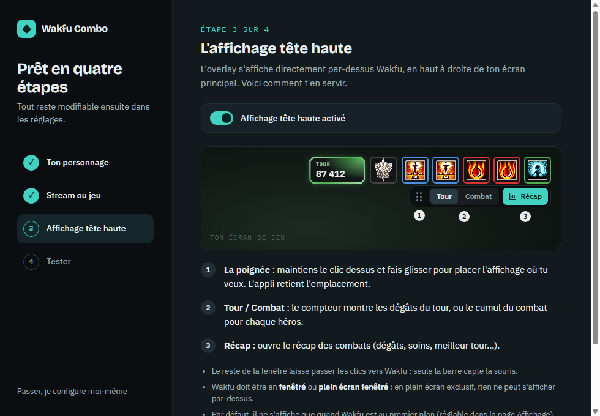

Tu peux passer l'assistant et tout configurer à la main. Tu peux aussi le relancer plus tard avec **Relancer l'assistant**, en bas de la barre latérale.

L'appli vit ensuite dans la **zone de notification Windows** (souvent rangée derrière la flèche `^` à côté de l'horloge). Fermer la fenêtre ne quitte **pas** l'appli : le suivi continue en arrière-plan pendant le stream. Pour la fermer complètement : clic droit sur l'icône → **Quitter**.

En arrière-plan, fenêtre fermée, l'appli occupe environ 5 Mo de mémoire.

---

## Sur macOS et Linux

L'appli fonctionne pareil que sous Windows. Seuls l'installation et quelques détails changent.

### macOS

1. Télécharge `wakfu-combo-overlay-X.Y.Z-macos.dmg` (une seule version pour les Mac Apple Silicon et Intel), ouvre-le et glisse **Wakfu Combo Overlay** dans **Applications**.
2. L'appli n'est pas signée par Apple (c'est payant). Au premier lancement, macOS refuse de l'ouvrir : ouvre **Réglages Système** → **Confidentialité et sécurité**, descends jusqu'au message sur Wakfu Combo Overlay et clique sur **Ouvrir quand même**. Sur les macOS plus anciens, un clic droit sur l'appli → **Ouvrir** suffit. Ce n'est à faire qu'une fois.

Lance-la bien depuis **Applications**, pas depuis le disque monté ni depuis Téléchargements : sinon macOS la fait tourner depuis une copie temporaire, et ni le lancement à l'ouverture de session ni les mises à jour ne peuvent marcher.

L'icône de l'appli est dans la **barre des menus**, en haut à droite. Un clic sur l'icône du Dock rouvre aussi les réglages.

### Linux

1. Télécharge `wakfu-combo-overlay-X.Y.Z-x86_64.AppImage`, rends-le exécutable (clic droit → Propriétés → « Autoriser l'exécution », ou `chmod +x` dans un terminal) et lance-le. Range-le d'abord là où il restera (par exemple `~/Applications`) : le lancement à l'ouverture de session et les mises à jour pointent vers ce fichier.
2. Sur Ubuntu 24.04 et plus récent, s'il ne se lance pas, installe `libfuse2t64` (`sudo apt install libfuse2t64`) ; sur les autres distributions, le paquet s'appelle en général `fuse2` ou `fuse-libs`.

L'icône vit dans la **zone de notification**. Sous GNOME (Fedora, Debian…), elle n'apparaît qu'avec l'extension **AppIndicator** (déjà là sur Ubuntu). Sans elle, relance simplement l'AppImage : l'appli déjà ouverte affiche ses réglages.

L'**affichage tête haute** a besoin de X11 : sur un bureau Wayland (GNOME, KDE…), l'appli passe toute seule par XWayland, comme Wakfu. Dans une session Wayland sans XWayland, il reste affiché par-dessus tout.

### Le dossier de logs

L'appli le cherche toute seule : celui du launcher Ankama (`~/.config/zaap/gamesLogs/wakfu/logs` sous Linux, `~/Library/Application Support/zaap/gamesLogs/wakfu/logs` sur Mac), puis, si tu fais tourner le client Windows avec Wine, Proton (Steam), Lutris, Bottles, CrossOver ou Whisky, celui de chaque préfixe trouvé. S'il en trouve plusieurs, il prend celui où le jeu a écrit en dernier. Sinon, indique-le dans **OBS & diagnostic** → **Configuration** : c'est le dossier qui contient `wakfu.log`.

---

## Gérer tes héros

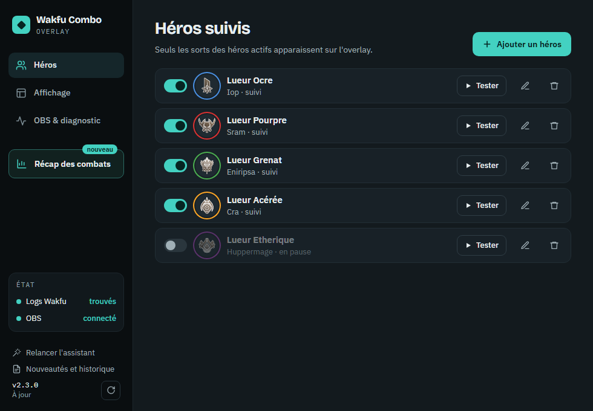

- **Ajouter un héros** : nom exact en jeu, classe et couleur. Le nom sert à le reconnaître dans les logs : avec une faute de frappe, il ne sera jamais détecté. La classe sert à choisir la bonne icône quand plusieurs classes ont un sort du même nom (ex. « Rafale » chez Iop et chez Cra). La couleur est celle de la bordure autour de ses icônes.
- **Interrupteur** : met un héros en pause sans le supprimer. Ses sorts sont alors ignorés.
- **Tester** : envoie un faux sort de ce héros à l'overlay, pour vérifier l'affichage sans lancer de combat.
- **Crayon** : modifier le nom, la classe ou la couleur. **Corbeille** : supprimer le héros (tu peux annuler juste après).

Tout est enregistré immédiatement, il n'y a pas de bouton « Enregistrer ».

---

## Régler l'affichage

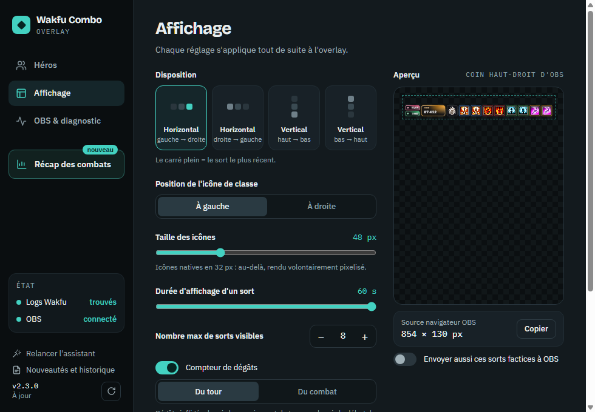

Chaque réglage s'applique tout de suite à l'overlay, et l'**aperçu** à droite montre le résultat en direct :

- **Disposition** : horizontale ou verticale, avec le sens d'apparition des nouveaux sorts.
- **Position de l'icône de classe** : le logo de la classe du dernier sort affiché se place à gauche ou à droite de la liste. Il disparaît quand plus aucun sort n'est à l'écran.
- **Taille des icônes** : de 16 à 128 px. Les icônes du jeu font 32 px : au-delà, elles sont agrandies en pixel art net, sans flou.
- **Durée d'affichage d'un sort** : de 1 à 60 s (6 s par défaut).
- **Nombre max de sorts visibles** : quand la limite est atteinte, le plus ancien disparaît.
- **Compteur de dégâts** : cumul des dégâts infligés, avec un « +N » à chaque coup. **Du tour** compte depuis le premier sort du tour, **Du combat** additionne tout le combat pour chaque héros (il repart de zéro au combat suivant). Il s'affiche à côté de l'icône de classe (dessous en vertical), à la couleur du héros. Les bombes du Roublard et les coups des invocations sont comptés ; le tir allié ne l'est pas. Activé par défaut, en mode « Du tour ».
  - À côté, deux petits compteurs montrent les **soins** (rose) et l'**armure** (vert) que le héros a donnés, sur le tour ou le combat selon le même réglage. Ils restent masqués tant qu'ils valent 0. Comme dans le récap, ils comptent pour celui qui les donne : le héros qui joue, le propriétaire d'une marque ou d'un passif nommé par le jeu, et le vol de vie pour celui qui se soigne.
- **Envoyer aussi ces sorts factices à OBS** : affiche les sorts de l'aperçu dans OBS, pour positionner la source précisément dans ta scène.

Sous l'aperçu, la carte **Source navigateur OBS** indique la taille exacte à donner à la source dans OBS (bouton **Copier**). Elle dépend de la disposition, de la taille des icônes, du nombre max de sorts et du compteur de dégâts. Pour 8 sorts visibles, compteur activé :

| Taille icône | Horizontale (L × H) | Verticale (L × H) |
|---|---|---|
| 32 px | 638 × 108 | 143 × 426 |
| 48 px | 854 × 130 | 188 × 554 |
| 64 px | 1070 × 152 | 234 × 682 |
| 96 px | 1502 × 196 | 324 × 938 |
| 128 px | 1934 × 240 | 415 × 1194 |

Sans les compteurs, la source est plus petite (ex. 478 × 76 en horizontal à 32 px) : fie-toi toujours à la valeur affichée dans l'appli.

> **Piège classique** : si la source OBS est plus petite que la taille indiquée, une partie des sorts sort du cadre. L'overlay garde alors ce qui tient à l'écran, en priorité les plus récents.

---

## Configurer OBS

La page **OBS & diagnostic** de l'appli rappelle toutes les étapes.

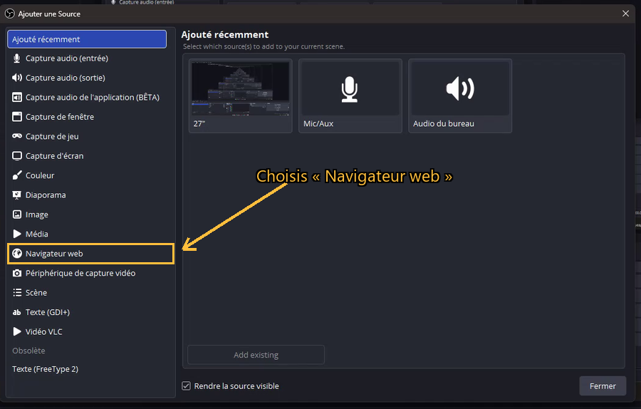

1. Dans la liste **Sources** de ta scène : **+** → **Navigateur**.
2. Renseigne l'adresse de l'overlay, avec l'une des deux méthodes ci-dessous.
3. **Largeur** / **Hauteur** : les valeurs indiquées par la page Affichage.
4. Place la source **au-dessus** de ta capture de jeu dans la liste des sources. La page a un fond transparent : elle se superpose directement au jeu.

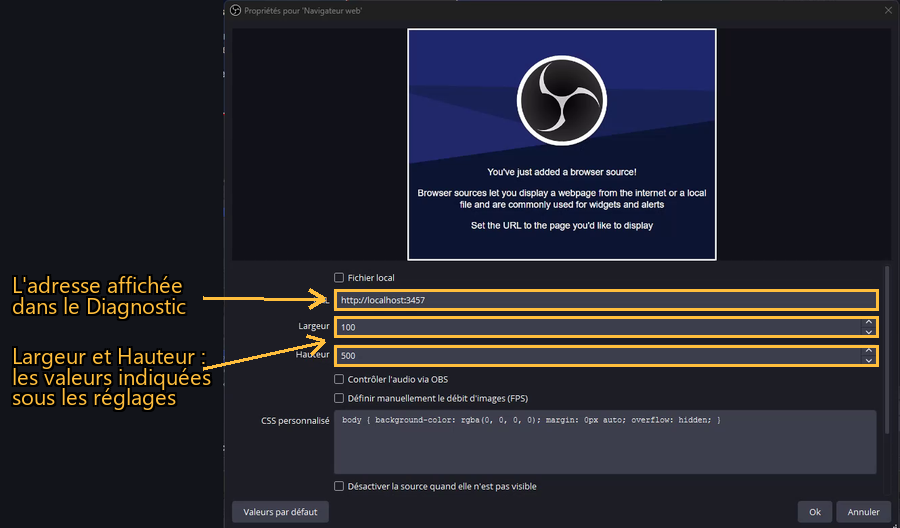

**Méthode 1 — Lien local (recommandé)** : laisse « Fichier local » décoché et colle `http://localhost:3457` dans **URL**. Le lien exact est affiché dans l'appli, avec un bouton **Copier**. L'appli doit être lancée avant OBS, sinon la source reste vide tant que tu ne l'actualises pas. Pour éviter ça, active **Lancer avec Windows**.

**Méthode 2 — Fichier local** : coche **Fichier local**, clique sur **Parcourir** et colle le chemin de `overlay-obs.html` dans le champ **Nom du fichier** de la fenêtre qui s'ouvre (pas dans la barre d'adresse en haut). Ce chemin est affiché dans l'onglet **Fichier local** de la page OBS & diagnostic, avec un bouton **Copier**. Cette page attend que l'appli soit lancée, puis ouvre l'overlay toute seule : ça marche même si OBS démarre en premier.

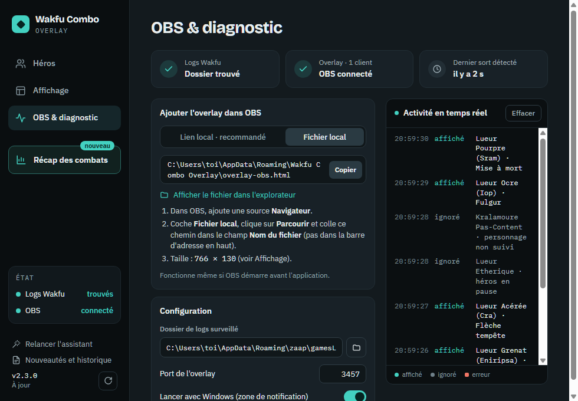

Pour tester, clique sur **Tester** en face d'un héros : son icône doit apparaître aussitôt dans l'aperçu OBS, sans lancer le stream ni l'enregistrement.

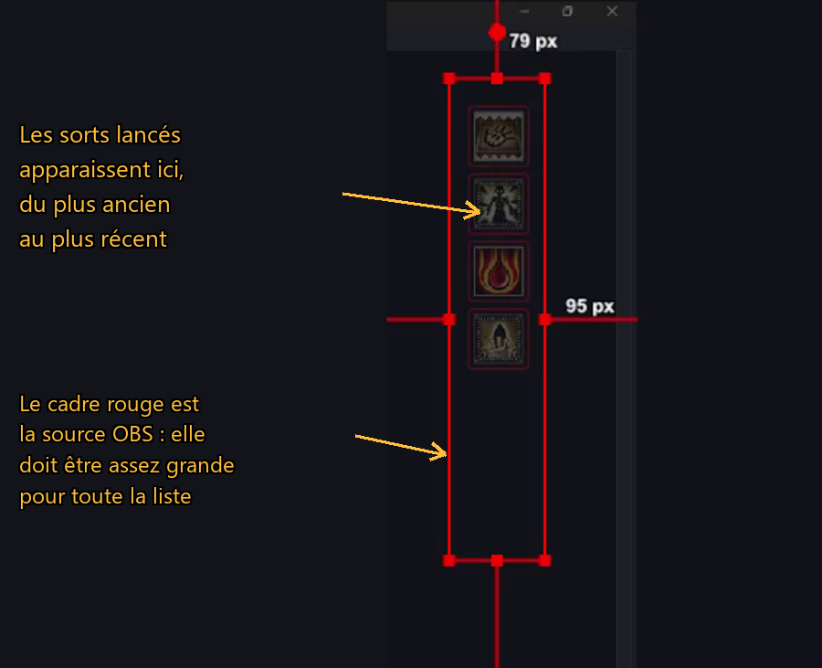

---

## Affichage tête haute (sans OBS)

Pas de stream, pas d'OBS ? L'appli peut afficher l'overlay **directement sur ton écran, par-dessus Wakfu**, comme un affichage tête haute : tu vois tes sorts et tes dégâts pendant que tu joues.

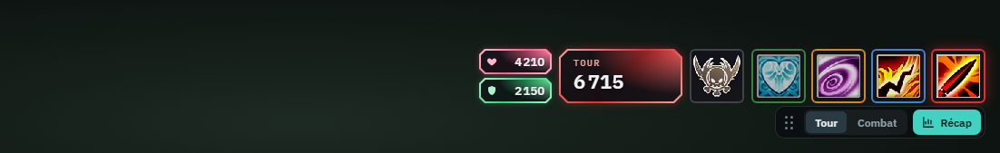

**L'activer**

1. Ouvre la page **Affichage** de l'appli.
2. Allume l'interrupteur **Affichage tête haute (sans OBS)**. Il apparaît en haut à droite de l'écran principal.

Tu peux aussi l'allumer ou l'éteindre sans ouvrir l'appli : clic droit sur son icône près de l'horloge Windows (dans la barre des menus sur Mac), puis **Affichage tête haute**.

Le bouton **Tuto**, à côté de l'interrupteur, rappelle comment t'en servir.

**La barre de contrôle**

Au-dessus de l'overlay (en dessous en vertical bas → haut), une petite barre réunit tout ce qui se clique :

- **La poignée** (les six points à gauche) : maintiens le clic dessus et fais glisser pour placer l'affichage où tu veux. L'appli retient cet emplacement pour les prochaines fois.
- **Tour / Combat** : ce que compte le compteur de dégâts, comme dans la page Affichage.
- **Récap** : ouvre le [récap des combats](#récap-des-combats).

La fenêtre prend toute seule la bonne taille d'après tes réglages d'affichage (disposition, taille des icônes, nombre de sorts, compteur), avec de la marge : rien n'est jamais coupé, même avec la liste pleine.

**Ce qu'il faut savoir**

- **Il ne gêne pas le jeu** : la fenêtre est transparente et tes clics passent au travers, comme si elle n'était pas là. Seule la barre de contrôle capte la souris.
- **Il n'apparaît que sur Wakfu** : dès que tu passes sur une autre fenêtre (navigateur, Discord…), il se cache, et il revient quand tu retournes en jeu. Tu préfères le voir tout le temps ? Éteins **Seulement quand Wakfu est au premier plan**.
- **Les réglages de la page Affichage s'appliquent aussi** : disposition, taille des icônes, durée, compteur de dégâts…
- **Mode d'affichage de Wakfu** : le jeu doit être en **fenêtré** ou en **plein écran fenêtré**. En plein écran « exclusif », Windows ne laisse aucune fenêtre s'afficher par-dessus le jeu (sur Mac, le plein écran ouvre un bureau à part où il ne suit pas).

Tu peux utiliser l'affichage tête haute et OBS en même temps : les deux montrent les mêmes sorts.

---

## Récap des combats

Le récap revient sur chaque combat de la session : qui a fait quoi, et comment. Ouvre-le avec le bouton **Récap des combats** de la barre latérale, depuis le menu de l'icône près de l'horloge, ou avec le bouton **Récap** de l'affichage tête haute. Un badge « nouveau » signale un combat que tu n'as pas encore regardé.

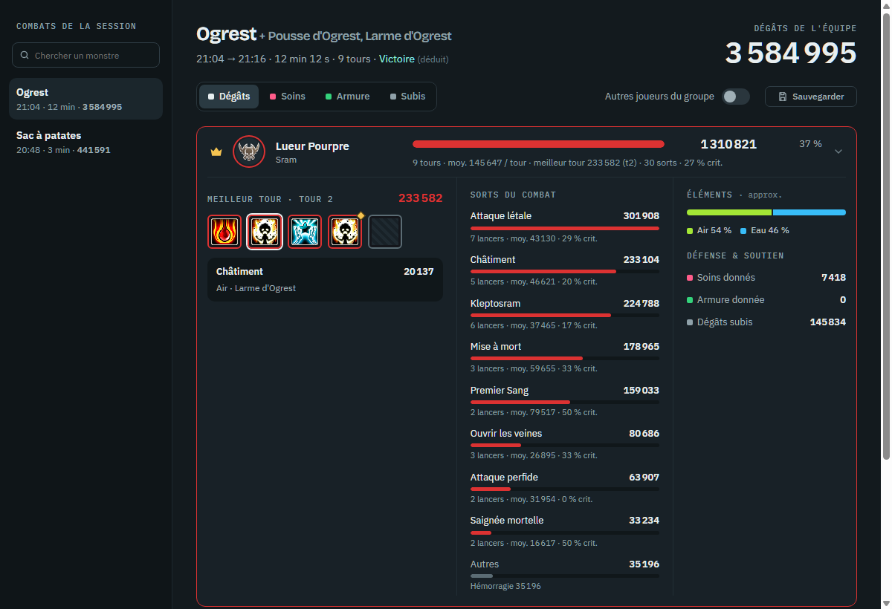

- **À gauche**, les combats de la session : adversaire, heure, durée, dégâts de l'équipe. Le combat en cours se remplit en direct.
  - **Chercher un monstre** propose dans une liste déroulante les monstres rencontrés, et ne garde que les combats où il était présent.
  - Survole un combat terminé pour faire apparaître sa **corbeille** : un second clic sur « Supprimer ? » le retire.
- **Sauvegarder**, à droite des onglets, garde le combat affiché après la fermeture de l'appli (dans `saved_fights.json`, à côté des réglages). Les combats sauvegardés des sessions précédentes s'affichent sous **Sauvegardés**, avec leur date ; la corbeille les retire.
- **En haut**, le combat choisi : adversaires, horaires, nombre de tours, et la victoire quand le jeu l'indique (XP gagnée en fin de combat).
- **Les onglets** classent tes héros en **Dégâts**, **Soins**, **Armure** (donnée) ou **Subis**, avec leur part de l'équipe.
- **Clique sur un héros** pour voir :
  - son **meilleur tour** avec les sorts lancés dans l'ordre (losange doré = critique). Survole un sort pour voir ce qu'il a fait, coup par coup et cible par cible ;
  - ses **sorts du combat**, avec le total, le nombre de lancers, la moyenne et le taux de critiques. Les sorts sans dégâts (buffs, invocations…) sont listés en grisé à la fin ;
  - la **répartition par élément**, ses soins, son armure et ses dégâts subis.
- Sans héros ouvert, le **meilleur tour du combat** s'affiche en bas : clique dessus pour ouvrir le détail du héros.
- **Autres joueurs du groupe** ajoute, en grisé, les joueurs que tu ne suis pas.

Dans l'onglet **Soins**, tout le détail passe aux soins : meilleur tour de soins, soins par sort (un sort de zone montre chaque cible soignée) et personnes soignées. L'onglet **Armure** fait de même pour l'armure donnée, avec les alliés protégés.

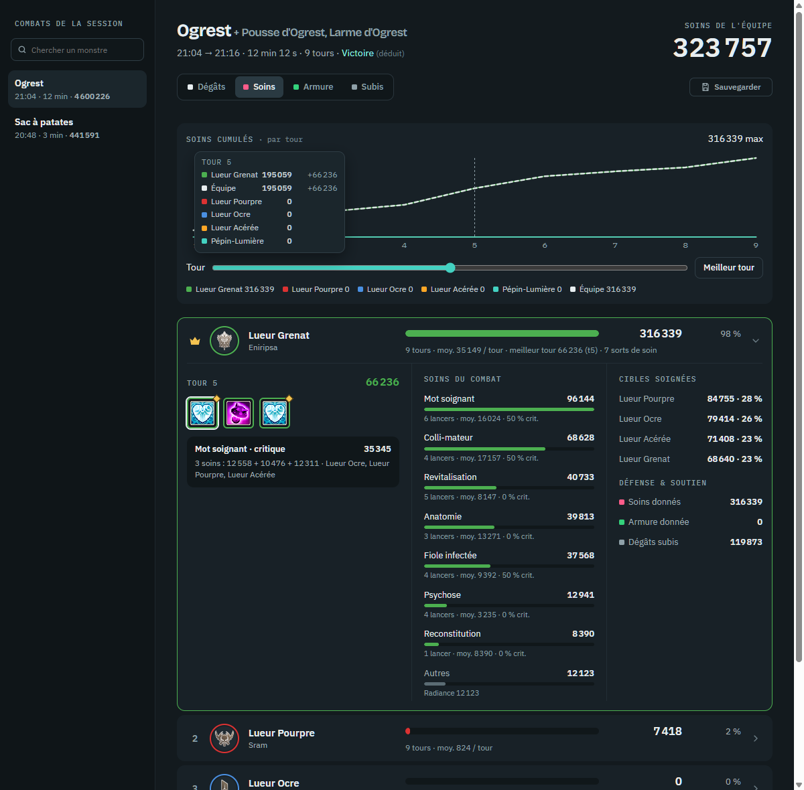

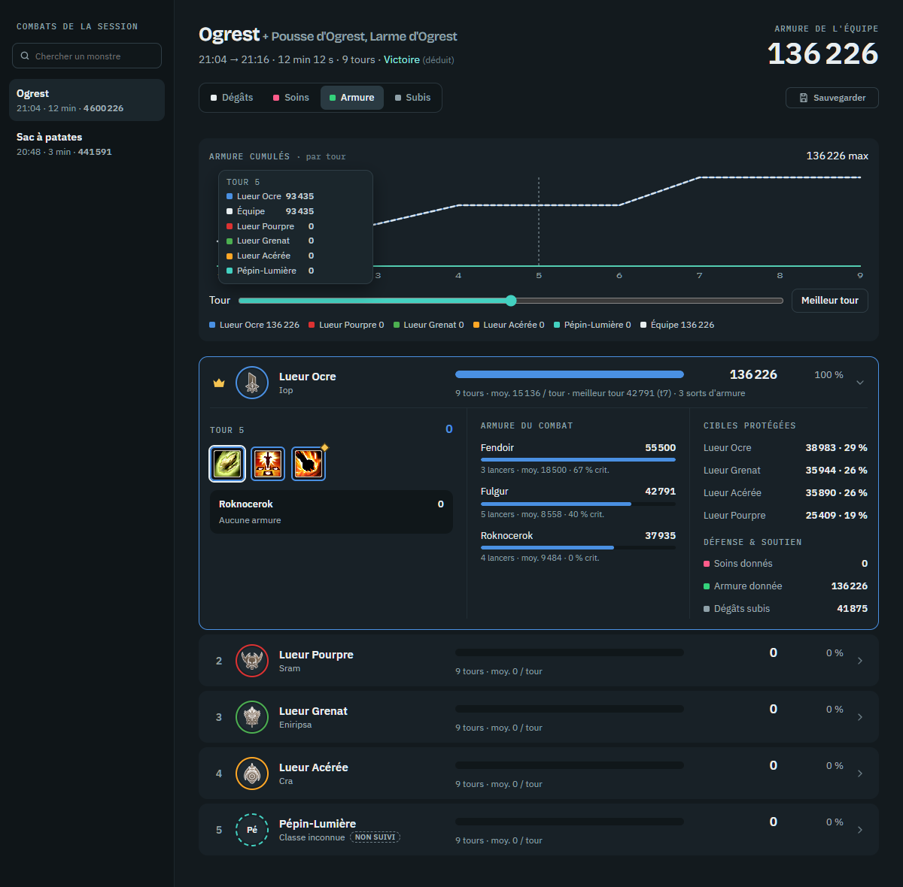

**Comment l'appli compte**

Le jeu indique qui reçoit les dégâts et les soins, mais pas toujours quel sort les a faits. L'appli les attribue au héros dont c'est le tour, et au sort que la ligne du jeu nomme, sinon au dernier sort lancé. Ce qu'aucun sort n'explique (poisons, effets de début de tour, glyphes…) est rangé dans **Autres**, sous son nom. Les soins et l'armure comptent pour **celui qui les donne**, pas pour celui qui les reçoit : le héros dont c'est le tour, sur le sort qu'il vient de lancer (une Faille qui protège deux alliés compte deux fois pour son lanceur). Le **vol de vie** compte pour celui qui se soigne, et les soins de marques et de passifs (« Marque Husse », « Radiance »…) vont au héros à qui ils appartiennent, même quand ils tombent pendant le tour d'un autre. Le jeu n'écrit pas les soins perdus (« +0 PV ») : un soin sur un allié déjà plein de vie ne compte pas.

Les combats sont gardés en mémoire jusqu'à ce que tu quittes l'appli (30 au plus), sauf ceux que tu sauvegardes.

---

## Vérifier que tout tourne

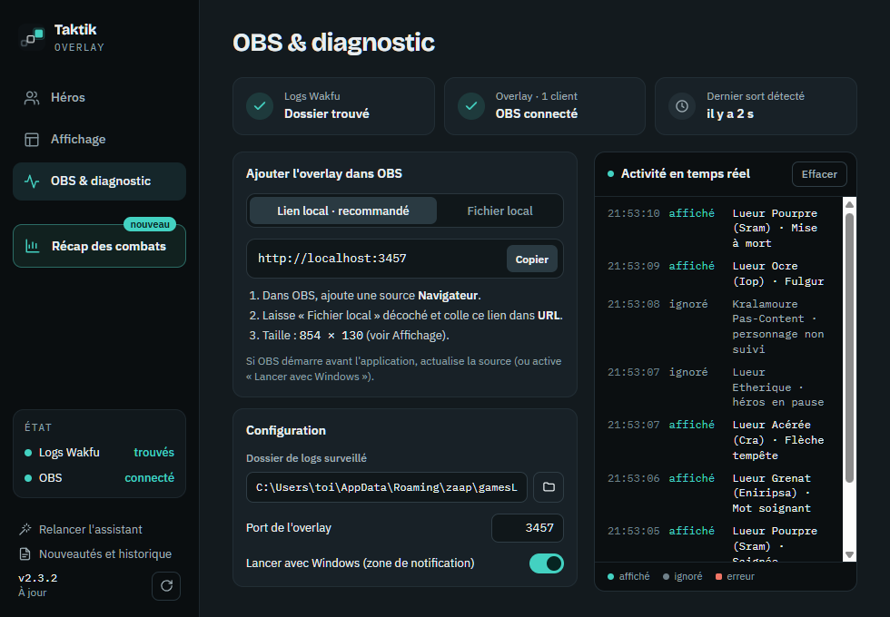

- **Logs Wakfu** : « Dossier trouvé » signifie que l'appli surveille le bon dossier. Sinon, corrige le chemin dans **Configuration** (bouton dossier pour parcourir).
- **Overlay** : nombre de sources connectées. À zéro, OBS n'est pas connecté à la page (mauvaise adresse, ou source pas encore chargée).
- **Dernier sort détecté** : le dernier sort envoyé à l'overlay.
- **Activité en temps réel** : chaque sort lu dans les logs et ce qu'il est devenu : *affiché*, *ignoré* (héros en pause, autre joueur, mob) ou *erreur*. C'est l'outil à regarder en premier quand un sort n'apparaît pas.

Le bloc **État** de la barre latérale résume tout ça en permanence. La carte **Configuration** permet aussi de changer le **port** de l'overlay et d'activer **Lancer avec Windows** (l'appli démarre alors directement dans la zone de notification).

### Mises à jour

L'appli installée vérifie toute seule s'il existe une nouvelle version quelques secondes après son lancement. Si oui, elle te demande avant de télécharger quoi que ce soit. Pour relancer la vérification à la main : bouton ↻ à côté du numéro de version (en bas de la barre latérale), ou **Vérifier les mises à jour** dans le menu de l'icône de notification.

Après une mise à jour, la fenêtre **Nouveautés** présente ce qui a changé, à l'ouverture des réglages. Pour la rouvrir : **Nouveautés et historique** en bas de la barre latérale (ou clic sur le numéro de version), ou **Nouveautés** dans le menu de l'icône de notification. **Voir tout l'historique des versions**, en bas de la fenêtre, affiche le changelog complet.

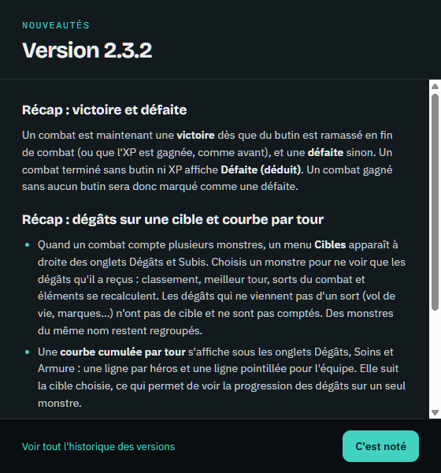

---

## Dépannage

**Rien ne s'affiche dans OBS**
- Regarde le compteur de sources connectées dans **OBS & diagnostic**. À zéro, OBS n'est pas connecté à la page : vérifie l'adresse.
- Vérifie l'ordre des sources dans OBS : la Source Navigateur doit être au-dessus de la capture de jeu.
- **OBS lancé avant l'appli** : avec le lien `http://localhost:…`, la source affiche une page d'erreur et ne réessaie jamais toute seule. Actualise la source, passe à la méthode **Fichier local**, ou active **Lancer avec Windows**.
- Une page qui vient de se charger reste vide jusqu'au prochain sort, c'est normal : les sorts déjà expirés ne sont pas réaffichés. Utilise **Tester** pour forcer un premier affichage.

**Un sort est détecté (visible dans l'activité) mais n'apparaît pas**
- Vérifie que le héros est actif (interrupteur allumé) et que son nom correspond exactement au nom en jeu.
- Vérifie que le sort a une icône dans `data/spellIcons.json`.

**Seuls les premiers sorts apparaissent**
- La source OBS est plus petite que la liste. Donne-lui la taille indiquée dans la page Affichage, ou réduis la taille des icônes ou le nombre max de sorts.

**L'affichage tête haute n'apparaît pas en jeu**
- Seule sa barre de contrôle reste visible tant qu'aucun sort n'est lancé : cherche-la en haut à droite de l'écran principal, ou utilise **Tester** dans la page Héros.
- Passe Wakfu en **fenêtré** ou **plein écran fenêtré** : le plein écran exclusif passe par-dessus toutes les fenêtres.
- S'il disparaît dès que tu changes de fenêtre, c'est voulu : voir **Seulement quand Wakfu est au premier plan** dans la page Affichage.

**Le dossier de logs est introuvable**
- Wakfu n'a peut-être jamais été lancé sur cette machine, ou il est installé ailleurs que via Zaap. Indique le bon dossier dans **Configuration**. Par défaut : `%APPDATA%\zaap\gamesLogs\wakfu\logs` (Mac et Linux : voir [Le dossier de logs](#le-dossier-de-logs)).

**« Port déjà utilisé » ou « Port réservé par Windows » au lancement**
- Une autre application utilise déjà le port 3457, ou Windows l'a réservé (Hyper-V, WSL, Docker) : change le port dans **Configuration**, puis mets à jour l'adresse dans OBS.

**Les sorts des invocations (créature Osamodas, poupée Sadida…)**
- Depuis la 1.6.0, les invocations sont rattachées automatiquement à leur invocateur : leurs sorts s'affichent sous le héros, avec une **bordure en pointillés**, et leurs dégâts entrent dans le compteur du tour. Leurs sorts ne figurent pas dans l'encyclopédie : à défaut d'icône propre, c'est l'icône du sort d'invocation qui est affichée.

**Le compteur de dégâts reste à 0 ou compte en double**
- À 0 : vérifie que le héros est actif et bien orthographié. Les coups portés à un allié (tir allié) ne sont pas comptés.
- En multi-compte, plusieurs clients écrivent les mêmes lignes dans le log : l'appli les déduplique toute seule.

**« Erreur de vérification » à côté du numéro de version**
- L'appli n'a pas pu lire `latest.json` dans la dernière release publiée : pas de connexion, ou la nouvelle release est encore en brouillon (draft). Publie-la, puis relance la vérification. Pour voir ce que voit l'updater :

```bash
curl -sL https://github.com/utruna/wakfu-combo-overlay/releases/latest/download/latest.json
```

---

## Développement

### Depuis la 2.0 : Tauri au lieu d'Electron

Jusqu'à la 1.6, l'appli était une appli **Electron** : elle embarquait son propre Chromium et Node.js, ce qui coûtait ~110 Mo de RAM en permanence (même fenêtre fermée) et un installeur de 126 Mo. Depuis la 2.0, c'est une appli **[Tauri](https://tauri.app)** :

| | 1.x (Electron) | 2.x (Tauri) |
|---|---|---|
| Logique (logs, tours, réglages, serveur overlay) | JavaScript (`src/`, `electron/main.js`) | **Rust** (`src-tauri/src/`) |
| Fenêtre de réglages | Chromium embarqué | WebView2, le moteur web de Windows |
| Pages (réglages, overlay) | HTML/JS dans `electron/` | le même HTML/JS, dans `ui/` |
| Lien page ↔ appli | `ipcMain` + `preload.js` | commandes Tauri + `ui/settings/tauri-api.js` |
| RAM fenêtre fermée / ouverte | ~110 Mo / ~110 Mo | **~5 Mo** / ~90 Mo |
| Installeur | 126 Mo | 8 Mo |

Ce qu'il faut retenir pour coder :

- **La fenêtre de réglages n'existe que tant qu'elle est ouverte.** La fermer la détruit, et WebView2 rend toute sa mémoire. L'appli tourne en Rust seul dans la zone de notification ; tout ce qui doit survivre à la fenêtre (lecture des logs, overlay, état) vit côté Rust.
- **La page n'a pas changé de modèle** : elle parle toujours à `window.settingsAPI`. Seule l'implémentation de ce pont a changé (`tauri-api.js` appelle `invoke()` au lieu d'`ipcRenderer`).
- **Ajouter une action appelée par la page**, c'est trois endroits : une fonction `#[tauri::command]` dans `src-tauri/src/commands.rs`, son enregistrement dans `generate_handler![…]` (`src-tauri/src/lib.rs`), et sa méthode dans `ui/settings/tauri-api.js`. Les arguments passent en camelCase côté JS (`characterName`) et arrivent en snake_case côté Rust (`character_name`).
- **Pousser un événement vers la page** (comme l'activité en temps réel) : `app.emit_to("settings", "nom:evenement", payload)` côté Rust, `listen()` côté `tauri-api.js`.
- **Les fichiers de `ui/` et `data/` sont embarqués dans l'exe** : la même copie sert la fenêtre de réglages et le serveur de l'overlay pour OBS.
- **Les réglages restent au même endroit** (`%APPDATA%\Wakfu Combo Overlay\settings.json`, même format) : une 1.x mise à jour garde tout, y compris le chemin `overlay-obs.html` collé dans OBS.

### Installer les outils (une seule fois)

Sous Windows, dans PowerShell :

```powershell
winget install Rustlang.Rustup
winget install Microsoft.VisualStudio.2022.BuildTools --override "--quiet --wait --norestart --add Microsoft.VisualStudio.Workload.VCTools --includeRecommended"
winget install OpenJS.NodeJS.LTS
```

Puis ouvre un **nouveau** terminal (pour que `cargo` et `node` soient dans le `PATH`). WebView2 est déjà installé sur Windows 10/11 à jour. Wakfu doit être installé via le launcher Zaap pour avoir de vrais logs.

Sur Mac : les outils Xcode (`xcode-select --install`), [Rust](https://rustup.rs) et Node.js. Sous Linux (Debian, Ubuntu) : Rust, Node.js et les bibliothèques de WebKitGTK :

```bash
sudo apt install build-essential pkg-config libwebkit2gtk-4.1-dev libayatana-appindicator3-dev librsvg2-dev libxdo-dev libssl-dev
```

### Lancer en dev

```bash
npm install
npm run dev
```

La première compilation prend quelques minutes (toutes les dépendances Rust), les suivantes quelques secondes. `npm run dev` surveille `src-tauri/` : une modification du Rust recompile et relance l'appli. Une modification de `ui/` se voit en rechargeant la fenêtre (Ctrl+R) ou, pour l'overlay, en actualisant la source dans OBS.

Pour tester sans toucher à tes vrais réglages (ni à l'instance déjà ouverte) :

```powershell
$env:WAKFU_OVERLAY_DATA_DIR = "$env:TEMP\wakfu-dev"
npm run dev
```

L'appli lit et écrit alors ses réglages dans ce dossier, et peut tourner à côté de l'instance installée (pense à y mettre un autre port que 3457 dans les réglages).

```bash
npm test      # tests Rust (cargo test) : log, tours, réglages, overlay
npm run lint  # ESLint (pages de ui/ et outils)
```

En dev, les messages de l'appli (`[debug] broadcast — …`, erreurs) s'affichent dans le terminal ; l'exe de release n'a pas de console.

### Générer un installeur

```bash
npm run dist
```

Produit l'installeur du système sur lequel tu es : Windows (NSIS) dans `src-tauri/target/release/bundle/nsis/`, AppImage dans `…/bundle/appimage/`, `.app` et `.dmg` dans `…/bundle/macos/` et `…/bundle/dmg/` (réglages propres à chaque système : `src-tauri/tauri.linux.conf.json`, `src-tauri/tauri.macos.conf.json`). Pour qu'il soit signé pour l'updater, définis d'abord la clé privée (voir ci-dessous) :

```powershell
$env:TAURI_SIGNING_PRIVATE_KEY = Get-Content "$env:USERPROFILE\.tauri\wakfu-combo-overlay.key" -Raw
$env:TAURI_SIGNING_PRIVATE_KEY_PASSWORD = ""
npm run dist
```

`npm run tauri build -- --no-bundle` ne produit que l'exe (`src-tauri/target/release/wakfu-combo-overlay.exe`), sans installeur ni signature.

### Publier une release

Le workflow `.github/workflows/release.yml` compile l'appli sur des runners Windows, Linux (Ubuntu 22.04) et macOS, et la publie en **GitHub Release** : pas besoin de commiter l'exe.

1. Monte la version dans `package.json` (`npm version patch` / `minor` / `major`). C'est la seule version à changer : `src-tauri/tauri.conf.json` la lit dans `package.json`.
2. Ajoute en haut de `CHANGELOG.md` une section `## vX.Y.Z` : c'est le texte de la release. Sans elle, le workflow s'arrête avant de créer le tag. Pousse les commits sur `main`.
3. Sur GitHub : **Actions** → **Build & Release** → **Run workflow**.
4. Une fois le workflow terminé (~15 min, moins quand le cache Rust est chaud), la release `vX.Y.Z` apparaît dans **Releases** avec `wakfu-combo-overlay-setup-X.Y.Z.exe`, `wakfu-combo-overlay-X.Y.Z-x86_64.AppImage`, `wakfu-combo-overlay-X.Y.Z-macos.dmg`, `wakfu-combo-overlay-X.Y.Z-macos.app.tar.gz` (ce que télécharge l'updater sur Mac), `latest.json` et `latest.yml`, et en notes la section du `CHANGELOG.md`, suivie de la liste des PR fusionnées générée par GitHub.

Le workflow vérifie d'abord que la version n'a pas déjà de release publiée, que le secret de signature existe et que le `CHANGELOG.md` a sa section, puis lance ESLint. Chaque système lance ensuite les tests et compile. Seulement si les trois réussissent, il crée et pousse le tag `vX.Y.Z`, crée la release en brouillon (ou réutilise le brouillon d'un essai raté), envoie les fichiers, puis publie la release. Elle n'est donc visible qu'une fois complète.

Sur Mac, l'appli n'a qu'une signature « ad hoc » (`signingIdentity: "-"`), sans compte développeur Apple : assez pour que macOS l'accepte sur Apple Silicon, mais Gatekeeper demande à l'utilisateur de l'autoriser une fois (voir [macOS](#macos)).

- `latest.json` est lu par l'updater de l'appli. Il contient, pour chaque système, la signature du fichier à télécharger : l'updater refuse toute mise à jour qui ne correspond pas à la clé publique de `src-tauri/tauri.conf.json`. La clé privée est le secret GitHub `TAURI_SIGNING_PRIVATE_KEY` du dépôt (copie locale : `%USERPROFILE%\.tauri\wakfu-combo-overlay.key`). Sans elle, impossible de publier une mise à jour que les installations existantes accepteront : garde-en une sauvegarde.
- `latest.yml` est lu par les anciennes versions 1.x (Electron), pour qu'elles proposent elles aussi la nouvelle version. L'installeur désinstalle alors la 1.x (`src-tauri/installer-hooks.nsh`).

Les deux updaters ne voient que les releases **publiées**, pas les brouillons.

### Fichiers et dossiers

- `src-tauri/src/lib.rs` : démarrage, zone de notification, fenêtre de réglages
- `src-tauri/src/app_state.rs` : lien entre le lecteur de logs, le suivi des tours et l'overlay
- `src-tauri/src/commands.rs` : commandes appelées par la fenêtre de réglages
- `src-tauri/src/log_reader.rs` : lecture incrémentale de `wakfu.log`
- `src-tauri/src/matcher.rs` : tri entre héros suivis et autres joueurs ou mobs
- `src-tauri/src/turn_tracker.rs` : découpage du combat en tours, cumul des dégâts, des soins et de l'armure, rattachement des invocations
- `src-tauri/src/fight_recap.rs` : enregistrement des combats pour le récap (sorts, coups, soins, armure, dégâts subis)
- `src-tauri/src/saved_fights.rs` : combats sauvegardés du récap (`saved_fights.json`)
- `src-tauri/src/ingame_window.rs` : fenêtre de l'affichage tête haute (barre de contrôle, déplacement, taille)
- `src-tauri/src/whats_new.rs` : fenêtre Nouveautés, tirée de `CHANGELOG.md`
- `src-tauri/src/settings.rs` : enregistrement des réglages
- `src-tauri/src/overlay_server.rs` : petit serveur HTTP/SSE de l'overlay
- `src-tauri/src/loader_page.rs` : génère `overlay-obs.html` (méthode Fichier local)
- `src-tauri/src/catalog.rs` : icônes des sorts et des classes
- `src-tauri/src/updates.rs`, `autostart.rs` : mises à jour, lancement à l'ouverture de session
- `src-tauri/src/user_dirs.rs` : dossiers de l'appli et des données, selon le système
- `src-tauri/tests/` : tests
- `ui/settings/` : fenêtre de réglages et assistant de premier lancement (`tauri-api.js` la relie aux commandes)
- `ui/overlay/` : page servie à OBS (et à l'affichage tête haute, avec `?ingame`)
- `ui/recap/` : fenêtre du récap des combats
- `ui/whatsnew/` : fenêtre Nouveautés
- `ui/assets/icons/` : icônes des sorts (par classe) et logos de classe (`classes/`)
- `data/spellIcons.json` : table nom de sort → icône, générée par `tools/scrape_spell_icons.js`

`ui/` et `data/` sont embarqués dans l'exe : la même copie sert la fenêtre de réglages et l'overlay.

Les réglages sont enregistrés dans `%APPDATA%\Wakfu Combo Overlay\settings.json` (macOS : `~/Library/Application Support/Wakfu Combo Overlay/`, Linux : `~/.config/wakfu-combo-overlay/`). Ce dossier est séparé de l'installation : les réglages survivent à une réinstallation.

### Régénérer les icônes de sorts

```bash
node tools/scrape_spell_icons.js
```

Le script récupère le nom officiel et l'icône de chaque sort des 18 classes depuis l'encyclopédie Wakfu. Il les range dans `ui/assets/icons/<classe>/<id>.png` et `data/spellIcons.json`, une table par classe (`{classe: {nomDuSort: {iconId, icon}}}`) pour qu'un sort partagé comme « Rafale » n'écrase pas celui de l'autre classe. Il récupère aussi le logo de chaque classe dans `ui/assets/icons/classes/<classe>.png`. Le script est volontairement lent : un premier lancement prend plusieurs dizaines de minutes, un relancement ne télécharge que ce qui manque.

`ui/assets/icons/` et `data/spellIcons.json` sont versionnés et embarqués dans l'exe. Relancer le scraper ne sert qu'après une mise à jour du jeu (nouveaux sorts, icônes retouchées).

Deux cas sont gérés à la main parce que l'encyclopédie officielle ne les documente pas :

- **Les 10 cartes de l'Écaflip** : noms et ids figés dans `ECAFLIP_CARDS`, repris de stratfu.fr et vérifiés un par un en combat (apostrophes droites comme en jeu).
- **Les 3 sorts communs** (Maîtrise d'Armes, Charme de Masse, Os à Moelle) : ids figés dans `COMMON_QUEST_SPELLS`, rangés sous la pseudo-classe `"commun"`. La recherche d'icône (`Catalog::spell_icon` dans `src-tauri/src/catalog.rs`) se rabat dessus pour n'importe quel héros.

Les images sont toujours téléchargées depuis Ankama. Les icônes restent la propriété d'Ankama et sont redistribuées ici dans le cadre d'un outil communautaire non commercial.

### Régénérer les captures d'écran

Ces outils lancent la vraie appli (build release : `npm run tauri build -- --no-bundle`) sur un profil de démo isolé (héros fictifs, faux `wakfu.log`, port dédié). Electron n'y sert que de navigateur de capture, téléchargé à la demande par `npx`. Depuis un terminal VS Code, retire d'abord la variable `ELECTRON_RUN_AS_NODE`, sinon Electron démarre comme un simple Node.

```bash
npx --yes electron@44 tools/capture_screenshots.js
```

Ce script refait `doc/app-*.png` et `doc/overlay-rendu.png` : réglages, assistant, récap des combats, Nouveautés et affichage tête haute. L'overlay est celui de l'appli ; les autres fenêtres sont affichées avec des commandes simulées à partir du profil de démo (`tools/demo_settings_preload.js`, qui fabrique aussi les combats de démo du récap et lit les notes de version dans `CHANGELOG.md`). Les captures `doc/obs-*.png` sont faites à la main dans OBS.

```bash
npx --yes electron@44 tools/capture_gif.js            # doc/overlay-demo.gif
npx --yes electron@44 tools/capture_gif.js vertical   # doc/overlay-demo-vertical.gif
```

Ce script enregistre le vrai overlay pendant qu'il rejoue un combat scénarisé (sorts, compteur de dégâts, soins et armure donnés, invocation Osamodas), écrit dans un faux `wakfu.log` au format du jeu.
