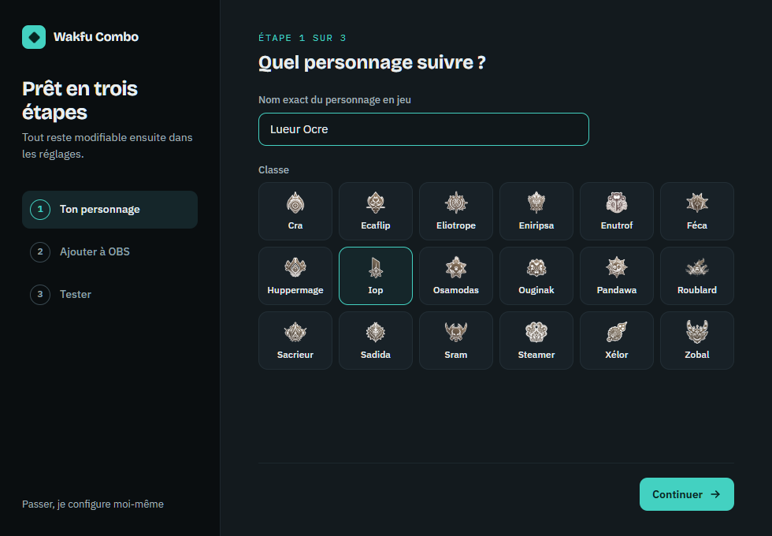
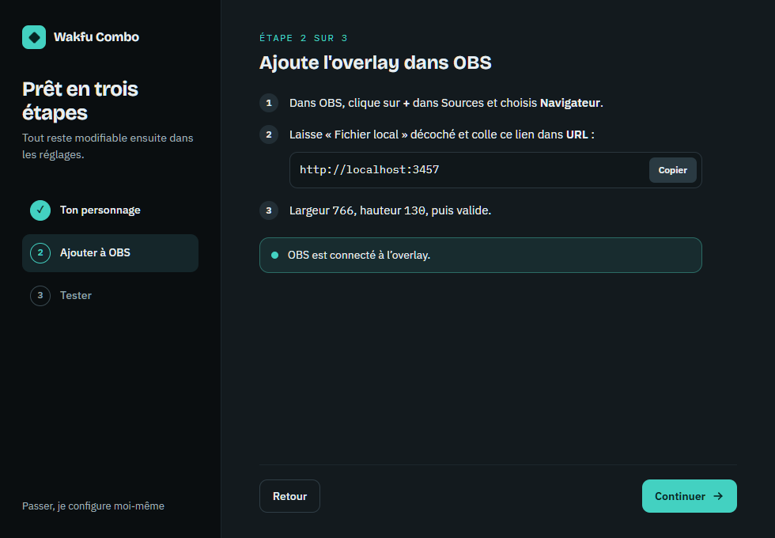
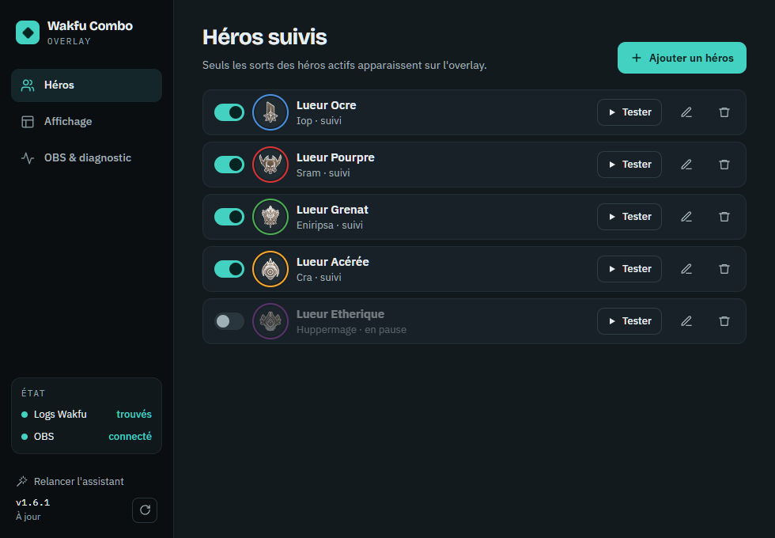
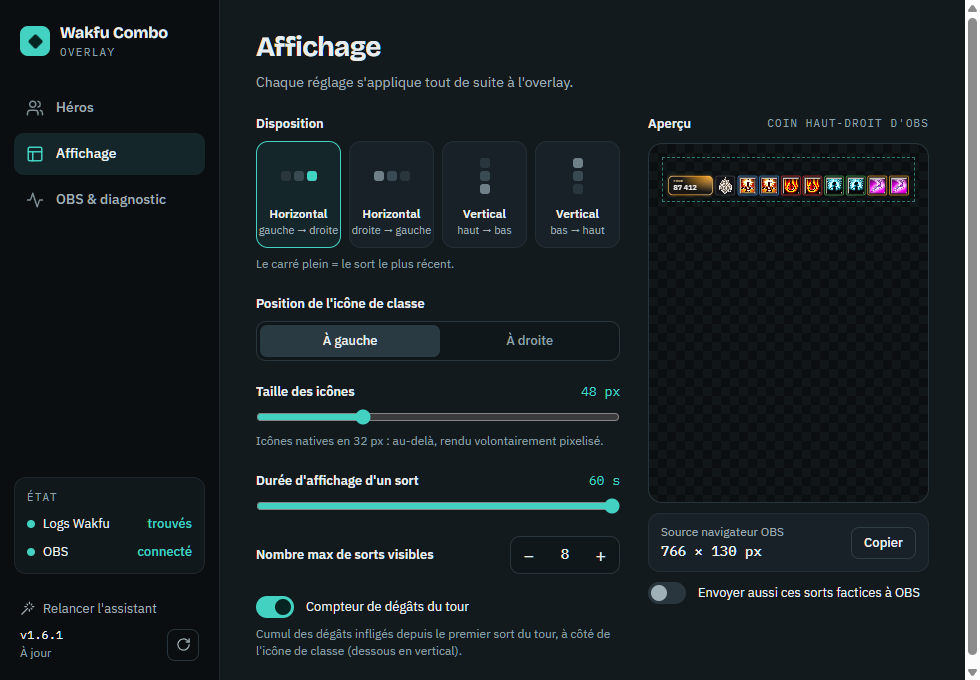
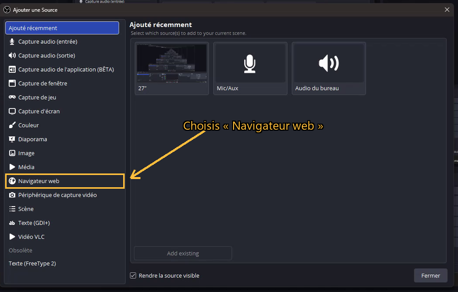
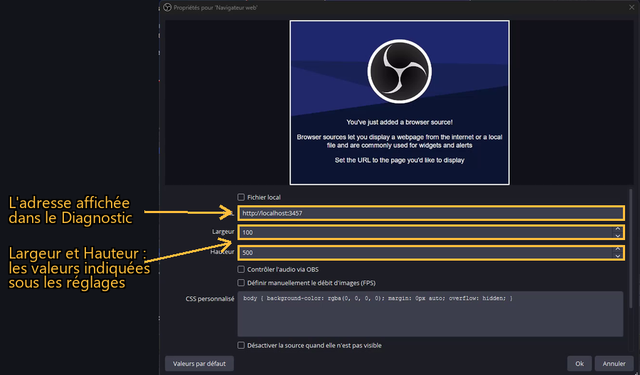
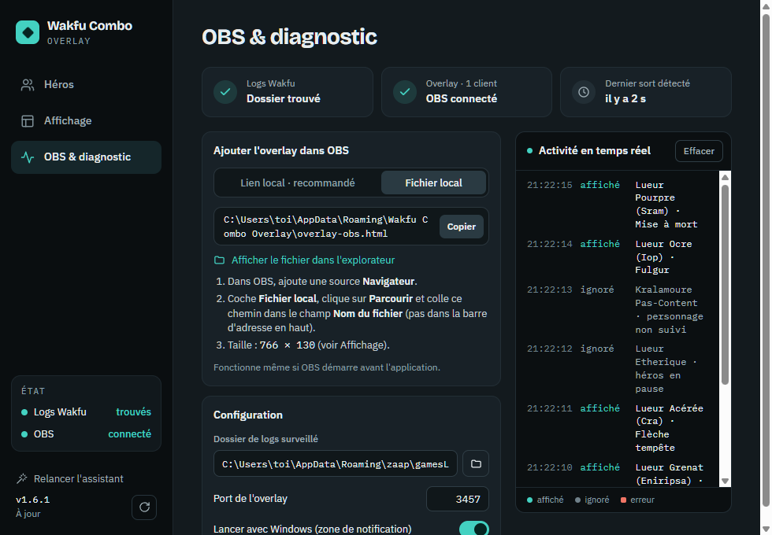
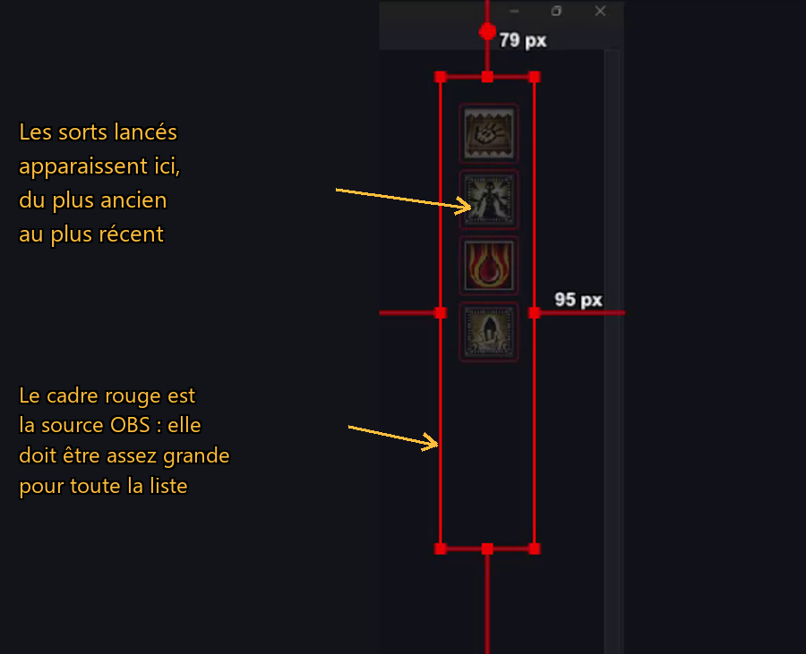
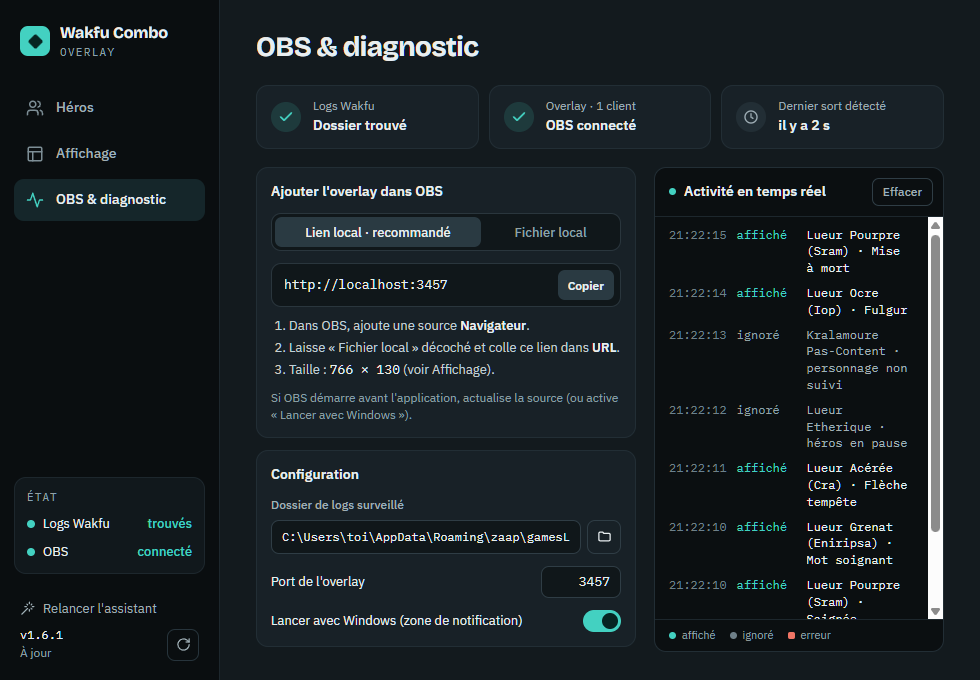

# Wakfu Combo Overlay

[](https://github.com/utruna/wakfu-combo-overlay/releases)
[](https://github.com/utruna/wakfu-combo-overlay/releases/latest)

Affiche en direct sur ton stream les sorts lancés par tes personnages Wakfu, sous forme d'icônes qui défilent dans OBS.


L'application lit les logs de combat du client Wakfu en temps réel. Elle ne garde que les sorts de tes personnages (les autres joueurs et les mobs sont ignorés) et les envoie à une page web transparente que tu ajoutes comme **Source Navigateur** dans OBS.

**[⬇ Télécharger la dernière version](https://github.com/utruna/wakfu-combo-overlay/releases/latest)** (Windows)

---

## Sommaire

- [Installation et premier lancement](#installation-et-premier-lancement)
- [Gérer tes héros](#gérer-tes-héros)
- [Régler l'affichage](#régler-laffichage)
- [Configurer OBS](#configurer-obs)
- [Vérifier que tout tourne](#vérifier-que-tout-tourne)
- [Dépannage](#dépannage)
- [Développement](#développement)

---

## Installation et premier lancement

1. Télécharge `wakfu-combo-overlay-setup-X.Y.Z.exe` depuis la [dernière release](https://github.com/utruna/wakfu-combo-overlay/releases/latest) et lance-le.
2. Windows SmartScreen peut afficher un avertissement, parce que l'installeur n'est pas signé : clique sur **Informations complémentaires** → **Exécuter quand même**.

Tu avais une version 1.x ? L'installeur la désinstalle tout seul et reprend tes réglages (héros, affichage, port, lancement avec Windows) : rien à refaire, ni dans l'appli ni dans OBS.

Au premier lancement, un **assistant en trois étapes** te guide :



1. **Ton personnage** : saisis son **nom exact en jeu** et choisis sa **classe**.
2. **Ajouter à OBS** : l'assistant te donne le lien à coller et la taille de la source, puis t'indique quand OBS est bien connecté.
3. **Tester** : envoie un sort factice et vérifie qu'il apparaît dans ta scène OBS.



Tu peux passer l'assistant et tout configurer à la main. Tu peux aussi le relancer plus tard avec **Relancer l'assistant**, en bas de la barre latérale.

L'appli vit ensuite dans la **zone de notification Windows** (souvent rangée derrière la flèche `^` à côté de l'horloge). Fermer la fenêtre ne quitte **pas** l'appli : le suivi continue en arrière-plan pendant le stream. Pour la fermer complètement : clic droit sur l'icône → **Quitter**.

En arrière-plan, fenêtre fermée, l'appli occupe environ 5 Mo de mémoire.

---

## Gérer tes héros



- **Ajouter un héros** : nom exact en jeu, classe et couleur. Le nom sert à le reconnaître dans les logs : avec une faute de frappe, il ne sera jamais détecté. La classe sert à choisir la bonne icône quand plusieurs classes ont un sort du même nom (ex. « Rafale » chez Iop et chez Cra). La couleur est celle de la bordure autour de ses icônes.
- **Interrupteur** : met un héros en pause sans le supprimer. Ses sorts sont alors ignorés.
- **Tester** : envoie un faux sort de ce héros à l'overlay, pour vérifier l'affichage sans lancer de combat.
- **Crayon** : modifier le nom, la classe ou la couleur. **Corbeille** : supprimer le héros (tu peux annuler juste après).

Tout est enregistré immédiatement, il n'y a pas de bouton « Enregistrer ».

---

## Régler l'affichage



Chaque réglage s'applique tout de suite à l'overlay, et l'**aperçu** à droite montre le résultat en direct :

- **Disposition** : horizontale ou verticale, avec le sens d'apparition des nouveaux sorts.
- **Position de l'icône de classe** : le logo de la classe du dernier sort affiché se place à gauche ou à droite de la liste. Il disparaît quand plus aucun sort n'est à l'écran.
- **Taille des icônes** : de 16 à 128 px. Les icônes du jeu font 32 px : au-delà, elles sont agrandies en pixel art net, sans flou.
- **Durée d'affichage d'un sort** : de 1 à 60 s (6 s par défaut).
- **Nombre max de sorts visibles** : quand la limite est atteinte, le plus ancien disparaît.
- **Compteur de dégâts du tour** : cumul des dégâts infligés depuis le premier sort du tour, avec un « +N » à chaque coup. Il s'affiche à côté de l'icône de classe (dessous en vertical), à la couleur du héros. Les bombes du Roublard et les coups des invocations sont comptés ; le tir allié ne l'est pas. Activé par défaut.
- **Envoyer aussi ces sorts factices à OBS** : affiche les sorts de l'aperçu dans OBS, pour positionner la source précisément dans ta scène.

Sous l'aperçu, la carte **Source navigateur OBS** indique la taille exacte à donner à la source dans OBS (bouton **Copier**). Elle dépend de la disposition, de la taille des icônes, du nombre max de sorts et du compteur de dégâts. Pour 8 sorts visibles, compteur activé :

| Taille icône | Horizontale (L × H) | Verticale (L × H) |
|---|---|---|
| 32 px | 577 × 108 | 143 × 497 |
| 48 px | 766 × 130 | 188 × 643 |
| 64 px | 956 × 152 | 234 × 791 |
| 96 px | 1334 × 196 | 324 × 1087 |
| 128 px | 1713 × 240 | 415 × 1382 |

Sans le compteur, la source est plus petite (ex. 478 × 76 en horizontal à 32 px) : fie-toi toujours à la valeur affichée dans l'appli.

> **Piège classique** : si la source OBS est plus petite que la taille indiquée, une partie des sorts sort du cadre. L'overlay garde alors ce qui tient à l'écran, en priorité les plus récents.

---

## Configurer OBS

La page **OBS & diagnostic** de l'appli rappelle toutes les étapes.



1. Dans la liste **Sources** de ta scène : **+** → **Navigateur**.
2. Renseigne l'adresse de l'overlay, avec l'une des deux méthodes ci-dessous.
3. **Largeur** / **Hauteur** : les valeurs indiquées par la page Affichage.
4. Place la source **au-dessus** de ta capture de jeu dans la liste des sources. La page a un fond transparent : elle se superpose directement au jeu.



**Méthode 1 — Lien local (recommandé)** : laisse « Fichier local » décoché et colle `http://localhost:3457` dans **URL**. Le lien exact est affiché dans l'appli, avec un bouton **Copier**. L'appli doit être lancée avant OBS, sinon la source reste vide tant que tu ne l'actualises pas. Pour éviter ça, active **Lancer avec Windows**.

**Méthode 2 — Fichier local** : coche **Fichier local**, clique sur **Parcourir** et colle le chemin de `overlay-obs.html` dans le champ **Nom du fichier** de la fenêtre qui s'ouvre (pas dans la barre d'adresse en haut). Ce chemin est affiché dans l'onglet **Fichier local** de la page OBS & diagnostic, avec un bouton **Copier**. Cette page attend que l'appli soit lancée, puis ouvre l'overlay toute seule : ça marche même si OBS démarre en premier.



Pour tester, clique sur **Tester** en face d'un héros : son icône doit apparaître aussitôt dans l'aperçu OBS, sans lancer le stream ni l'enregistrement.



---

## Vérifier que tout tourne



- **Logs Wakfu** : « Dossier trouvé » signifie que l'appli surveille le bon dossier. Sinon, corrige le chemin dans **Configuration** (bouton dossier pour parcourir).
- **Overlay** : nombre de sources connectées. À zéro, OBS n'est pas connecté à la page (mauvaise adresse, ou source pas encore chargée).
- **Dernier sort détecté** : le dernier sort envoyé à l'overlay.
- **Activité en temps réel** : chaque sort lu dans les logs et ce qu'il est devenu : *affiché*, *ignoré* (héros en pause, autre joueur, mob) ou *erreur*. C'est l'outil à regarder en premier quand un sort n'apparaît pas.

Le bloc **État** de la barre latérale résume tout ça en permanence. La carte **Configuration** permet aussi de changer le **port** de l'overlay et d'activer **Lancer avec Windows** (l'appli démarre alors directement dans la zone de notification).

### Mises à jour

L'appli installée vérifie toute seule s'il existe une nouvelle version quelques secondes après son lancement. Si oui, elle te demande avant de télécharger quoi que ce soit. Pour relancer la vérification à la main : bouton ↻ à côté du numéro de version (en bas de la barre latérale), ou **Vérifier les mises à jour** dans le menu de l'icône de notification.

---

## Dépannage

**Rien ne s'affiche dans OBS**
- Regarde le compteur de sources connectées dans **OBS & diagnostic**. À zéro, OBS n'est pas connecté à la page : vérifie l'adresse.
- Vérifie l'ordre des sources dans OBS : la Source Navigateur doit être au-dessus de la capture de jeu.
- **OBS lancé avant l'appli** : avec le lien `http://localhost:…`, la source affiche une page d'erreur et ne réessaie jamais toute seule. Actualise la source, passe à la méthode **Fichier local**, ou active **Lancer avec Windows**.
- Une page qui vient de se charger reste vide jusqu'au prochain sort, c'est normal : les sorts déjà expirés ne sont pas réaffichés. Utilise **Tester** pour forcer un premier affichage.

**Un sort est détecté (visible dans l'activité) mais n'apparaît pas**
- Vérifie que le héros est actif (interrupteur allumé) et que son nom correspond exactement au nom en jeu.
- Vérifie que le sort a une icône dans `data/spellIcons.json`.

**Seuls les premiers sorts apparaissent**
- La source OBS est plus petite que la liste. Donne-lui la taille indiquée dans la page Affichage, ou réduis la taille des icônes ou le nombre max de sorts.

**Le dossier de logs est introuvable**
- Wakfu n'a peut-être jamais été lancé sur cette machine, ou il est installé ailleurs que via Zaap. Indique le bon dossier dans **Configuration**. Par défaut : `%APPDATA%\zaap\gamesLogs\wakfu\logs`.

**« Port déjà utilisé » ou « Port réservé par Windows » au lancement**
- Une autre application utilise déjà le port 3457, ou Windows l'a réservé (Hyper-V, WSL, Docker) : change le port dans **Configuration**, puis mets à jour l'adresse dans OBS.

**Les sorts des invocations (créature Osamodas, poupée Sadida…)**
- Depuis la 1.6.0, les invocations sont rattachées automatiquement à leur invocateur : leurs sorts s'affichent sous le héros, avec une **bordure en pointillés**, et leurs dégâts entrent dans le compteur du tour. Leurs sorts ne figurent pas dans l'encyclopédie : à défaut d'icône propre, c'est l'icône du sort d'invocation qui est affichée.

**Le compteur de dégâts reste à 0 ou compte en double**
- À 0 : vérifie que le héros est actif et bien orthographié. Les coups portés à un allié (tir allié) ne sont pas comptés.
- En multi-compte, plusieurs clients écrivent les mêmes lignes dans le log : l'appli les déduplique toute seule.

**« Erreur de vérification » à côté du numéro de version**
- L'appli n'a pas pu lire `latest.json` dans la dernière release publiée : pas de connexion, ou la nouvelle release est encore en brouillon (draft). Publie-la, puis relance la vérification. Pour voir ce que voit l'updater :

```bash
curl -sL https://github.com/utruna/wakfu-combo-overlay/releases/latest/download/latest.json
```

---

## Développement

### Depuis la 2.0 : Tauri au lieu d'Electron

Jusqu'à la 1.6, l'appli était une appli **Electron** : elle embarquait son propre Chromium et Node.js, ce qui coûtait ~110 Mo de RAM en permanence (même fenêtre fermée) et un installeur de 126 Mo. Depuis la 2.0, c'est une appli **[Tauri](https://tauri.app)** :

| | 1.x (Electron) | 2.x (Tauri) |
|---|---|---|
| Logique (logs, tours, réglages, serveur overlay) | JavaScript (`src/`, `electron/main.js`) | **Rust** (`src-tauri/src/`) |
| Fenêtre de réglages | Chromium embarqué | WebView2, le moteur web de Windows |
| Pages (réglages, overlay) | HTML/JS dans `electron/` | le même HTML/JS, dans `ui/` |
| Lien page ↔ appli | `ipcMain` + `preload.js` | commandes Tauri + `ui/settings/tauri-api.js` |
| RAM fenêtre fermée / ouverte | ~110 Mo / ~110 Mo | **~5 Mo** / ~90 Mo |
| Installeur | 126 Mo | 8 Mo |

Ce qu'il faut retenir pour coder :

- **La fenêtre de réglages n'existe que tant qu'elle est ouverte.** La fermer la détruit, et WebView2 rend toute sa mémoire. L'appli tourne en Rust seul dans la zone de notification ; tout ce qui doit survivre à la fenêtre (lecture des logs, overlay, état) vit côté Rust.
- **La page n'a pas changé de modèle** : elle parle toujours à `window.settingsAPI`. Seule l'implémentation de ce pont a changé (`tauri-api.js` appelle `invoke()` au lieu d'`ipcRenderer`).
- **Ajouter une action appelée par la page**, c'est trois endroits : une fonction `#[tauri::command]` dans `src-tauri/src/commands.rs`, son enregistrement dans `generate_handler![…]` (`src-tauri/src/lib.rs`), et sa méthode dans `ui/settings/tauri-api.js`. Les arguments passent en camelCase côté JS (`characterName`) et arrivent en snake_case côté Rust (`character_name`).
- **Pousser un événement vers la page** (comme l'activité en temps réel) : `app.emit_to("settings", "nom:evenement", payload)` côté Rust, `listen()` côté `tauri-api.js`.
- **Les fichiers de `ui/` et `data/` sont embarqués dans l'exe** : la même copie sert la fenêtre de réglages et le serveur de l'overlay pour OBS.
- **Les réglages restent au même endroit** (`%APPDATA%\Wakfu Combo Overlay\settings.json`, même format) : une 1.x mise à jour garde tout, y compris le chemin `overlay-obs.html` collé dans OBS.

### Installer les outils (une seule fois)

Windows uniquement (chemin des logs Wakfu, zone de notification). Dans PowerShell :

```powershell
winget install Rustlang.Rustup
winget install Microsoft.VisualStudio.2022.BuildTools --override "--quiet --wait --norestart --add Microsoft.VisualStudio.Workload.VCTools --includeRecommended"
winget install OpenJS.NodeJS.LTS
```

Puis ouvre un **nouveau** terminal (pour que `cargo` et `node` soient dans le `PATH`). WebView2 est déjà installé sur Windows 10/11 à jour. Wakfu doit être installé via le launcher Zaap pour avoir de vrais logs.

### Lancer en dev

```bash
npm install
npm run dev
```

La première compilation prend quelques minutes (toutes les dépendances Rust), les suivantes quelques secondes. `npm run dev` surveille `src-tauri/` : une modification du Rust recompile et relance l'appli. Une modification de `ui/` se voit en rechargeant la fenêtre (Ctrl+R) ou, pour l'overlay, en actualisant la source dans OBS.

Pour tester sans toucher à tes vrais réglages (ni à l'instance déjà ouverte) :

```powershell
$env:WAKFU_OVERLAY_DATA_DIR = "$env:TEMP\wakfu-dev"
npm run dev
```

L'appli lit et écrit alors ses réglages dans ce dossier, et peut tourner à côté de l'instance installée (pense à y mettre un autre port que 3457 dans les réglages).

```bash
npm test      # tests Rust (cargo test) : log, tours, réglages, overlay
npm run lint  # ESLint (pages de ui/ et outils)
```

En dev, les messages de l'appli (`[debug] broadcast — …`, erreurs) s'affichent dans le terminal ; l'exe de release n'a pas de console.

### Générer un installeur

```bash
npm run dist
```

Produit l'installeur Windows (NSIS) dans `src-tauri/target/release/bundle/nsis/`. Pour qu'il soit signé pour l'updater, définis d'abord la clé privée (voir ci-dessous) :

```powershell
$env:TAURI_SIGNING_PRIVATE_KEY = Get-Content "$env:USERPROFILE\.tauri\wakfu-combo-overlay.key" -Raw
$env:TAURI_SIGNING_PRIVATE_KEY_PASSWORD = ""
npm run dist
```

`npm run tauri build -- --no-bundle` ne produit que l'exe (`src-tauri/target/release/wakfu-combo-overlay.exe`), sans installeur ni signature.

### Publier une release

Le workflow `.github/workflows/release.yml` compile l'installeur sur un runner Windows et le publie en **GitHub Release** : pas besoin de commiter l'exe.

1. Monte la version dans `package.json` (`npm version patch` / `minor` / `major`) et pousse le commit sur `main`. C'est la seule version à changer : `src-tauri/tauri.conf.json` la lit dans `package.json`.
2. Sur GitHub : **Actions** → **Build & Release (Windows)** → **Run workflow**.
3. Une fois le workflow terminé (~10 min, moins quand le cache Rust est chaud), la release `vX.Y.Z` apparaît dans **Releases** avec l'installeur `wakfu-combo-overlay-setup-X.Y.Z.exe`, `latest.json` et `latest.yml`, et des notes générées à partir des commits.

Le workflow vérifie que la version n'a pas déjà de release publiée et que le secret de signature existe, crée et pousse le tag `vX.Y.Z`, crée la release en brouillon (ou réutilise le brouillon d'un essai raté), lance ESLint et les tests, compile, envoie les fichiers, puis publie la release. Elle n'est donc visible qu'une fois complète.

- `latest.json` est lu par l'updater de l'appli. Il contient la signature de l'installeur : l'updater refuse toute mise à jour qui ne correspond pas à la clé publique de `src-tauri/tauri.conf.json`. La clé privée est le secret GitHub `TAURI_SIGNING_PRIVATE_KEY` du dépôt (copie locale : `%USERPROFILE%\.tauri\wakfu-combo-overlay.key`). Sans elle, impossible de publier une mise à jour que les installations existantes accepteront : garde-en une sauvegarde.
- `latest.yml` est lu par les anciennes versions 1.x (Electron), pour qu'elles proposent elles aussi la nouvelle version. L'installeur désinstalle alors la 1.x (`src-tauri/installer-hooks.nsh`).

Les deux updaters ne voient que les releases **publiées**, pas les brouillons.

### Fichiers et dossiers

- `src-tauri/src/lib.rs` : démarrage, zone de notification, fenêtre de réglages
- `src-tauri/src/app_state.rs` : lien entre le lecteur de logs, le suivi des tours et l'overlay
- `src-tauri/src/commands.rs` : commandes appelées par la fenêtre de réglages
- `src-tauri/src/log_reader.rs` : lecture incrémentale de `wakfu.log`
- `src-tauri/src/matcher.rs` : tri entre héros suivis et autres joueurs ou mobs
- `src-tauri/src/turn_tracker.rs` : découpage du combat en tours, cumul des dégâts, rattachement des invocations
- `src-tauri/src/settings.rs` : enregistrement des réglages
- `src-tauri/src/overlay_server.rs` : petit serveur HTTP/SSE de l'overlay
- `src-tauri/src/loader_page.rs` : génère `overlay-obs.html` (méthode Fichier local)
- `src-tauri/src/catalog.rs` : icônes des sorts et des classes
- `src-tauri/src/updates.rs`, `autostart.rs` : mises à jour, lancement avec Windows
- `src-tauri/tests/` : tests
- `ui/settings/` : fenêtre de réglages et assistant de premier lancement (`tauri-api.js` la relie aux commandes)
- `ui/overlay/` : page servie à OBS
- `ui/assets/icons/` : icônes des sorts (par classe) et logos de classe (`classes/`)
- `data/spellIcons.json` : table nom de sort → icône, générée par `tools/scrape_spell_icons.js`

`ui/` et `data/` sont embarqués dans l'exe : la même copie sert la fenêtre de réglages et l'overlay.

Les réglages sont enregistrés dans `%APPDATA%\Wakfu Combo Overlay\settings.json`. Ce dossier est séparé de l'installation : les réglages survivent à une réinstallation.

### Régénérer les icônes de sorts

```bash
node tools/scrape_spell_icons.js
```

Le script récupère le nom officiel et l'icône de chaque sort des 18 classes depuis l'encyclopédie Wakfu. Il les range dans `ui/assets/icons/<classe>/<id>.png` et `data/spellIcons.json`, une table par classe (`{classe: {nomDuSort: {iconId, icon}}}`) pour qu'un sort partagé comme « Rafale » n'écrase pas celui de l'autre classe. Il récupère aussi le logo de chaque classe dans `ui/assets/icons/classes/<classe>.png`. Le script est volontairement lent : un premier lancement prend plusieurs dizaines de minutes, un relancement ne télécharge que ce qui manque.

`ui/assets/icons/` et `data/spellIcons.json` sont versionnés et embarqués dans l'exe. Relancer le scraper ne sert qu'après une mise à jour du jeu (nouveaux sorts, icônes retouchées).

Deux cas sont gérés à la main parce que l'encyclopédie officielle ne les documente pas :

- **Les 10 cartes de l'Écaflip** : noms et ids figés dans `ECAFLIP_CARDS`, repris de stratfu.fr et vérifiés un par un en combat (apostrophes droites comme en jeu).
- **Les 3 sorts communs** (Maîtrise d'Armes, Charme de Masse, Os à Moelle) : ids figés dans `COMMON_QUEST_SPELLS`, rangés sous la pseudo-classe `"commun"`. La recherche d'icône (`Catalog::spell_icon` dans `src-tauri/src/catalog.rs`) se rabat dessus pour n'importe quel héros.

Les images sont toujours téléchargées depuis Ankama. Les icônes restent la propriété d'Ankama et sont redistribuées ici dans le cadre d'un outil communautaire non commercial.

### Régénérer les captures d'écran

Ces outils lancent la vraie appli (build release : `npm run tauri build -- --no-bundle`) sur un profil de démo isolé (héros fictifs, faux `wakfu.log`, port dédié). Electron n'y sert que de navigateur de capture, téléchargé à la demande par `npx`. Depuis un terminal VS Code, retire d'abord la variable `ELECTRON_RUN_AS_NODE`, sinon Electron démarre comme un simple Node.

```bash
npx --yes electron@44 tools/capture_screenshots.js
```

Ce script refait `doc/app-*.png` et `doc/overlay-rendu.png`. L'overlay est celui de l'appli ; la page de réglages est affichée avec des commandes simulées à partir du profil de démo (`tools/demo_settings_preload.js`). Les captures `doc/obs-*.png` sont faites à la main dans OBS.

```bash
npx --yes electron@44 tools/capture_gif.js            # doc/overlay-demo.gif
npx --yes electron@44 tools/capture_gif.js vertical   # doc/overlay-demo-vertical.gif
```

Ce script enregistre le vrai overlay pendant qu'il rejoue un combat scénarisé (sorts, compteur de dégâts, invocation Osamodas), écrit dans un faux `wakfu.log` au format du jeu.
